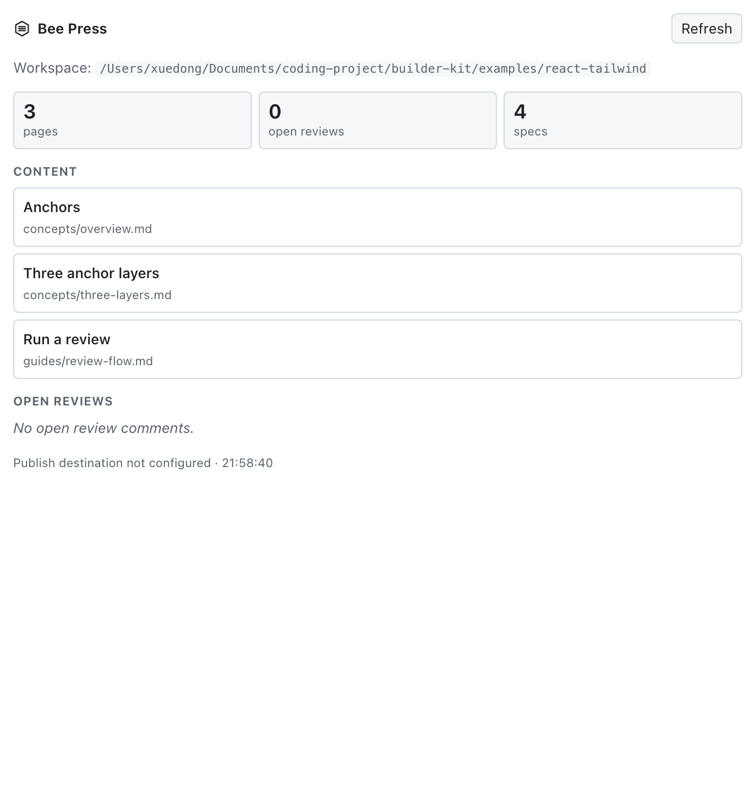

# Bee Press

**A hive of agents. One source of truth.**

Bee Press is the prototype-native content production and publishing layer. Turn
a running prototype into source-grounded manuals, launch notes, message cards,
campaign copy, screenshots, GIFs and clips — review them in place, keep them
fresh, and deliver them through a pluggable destination layer.

[](./LICENSE)
[](https://nodejs.org/)

[中文文档](./README.zh-CN.md) · [Brand guide](./docs/brand.md)

> **Name:** Bee Press is the product name. The npm package and import paths
> are `beepress`. The `builder-kit` package and CLI remain as compatibility
> aliases, and `BUILDER_KIT_*` environment variables are still accepted.

Bee Press attaches two independent tools to a running prototype:

| Tool | What it does | Where it lands |
|---|---|---|
| **Review** | Collects opinions about the running prototype — select an element and leave a comment anchored to its source | `docs/reviews/<REGION>.json` |
| **Studio** | Turns the prototype into publishable content — manuals, launch notes, message cards, campaign copy, screenshots and clips | `docs/kb/*.md`, `images/`, `media/`, publishing state |

The UI is React and lives in an isolated root under `<body>`. A thin host adapter mounts it; the prototype keeps its own framework. **React is the primary adapter**; a **Vue 2** adapter is optional. Writing an adapter for Vue 3 or another framework is intentionally small (three responsibilities: layout slots, router bridge, host controls).

The toolkit is **dev-only**. Production builds contain no Bee Press code and no React.

---

## Content positioning

Bee Press is not a generic AI writing tool. It gives an Agent a verifiable
prototype environment to work from:

- the Agent reads source, routes, components, FRS and DOM state instead of
  guessing the UI;
- Chrome/CDP captures screenshots and recordings, and ffmpeg builds GIFs,
  videos and composites; media is reproducible, not a manual attachment;
- facts reference `frs:` / `code:` sources and re-enter review when upstream
  changes;
- one content bundle can become a manual, launch note, message card or campaign
  asset, then go through a destination adapter to Feishu, Tencent Docs, an
  internal platform or IM;
- Markdown, media recipes, facts and review locks stay in the repository:
  diffable, rollbackable and editable by the Agent.

In one sentence: **Bee Press is the prototype-native content production and
publishing layer, not a generic document editor or screenshot tool.**

## Why the hive

Bee Press is not a chat box with a human in the middle. It is a hive of
specialised agents working on shared artifacts:

- **Worker roles** — reading source, inspecting pages, capturing screenshots and
  clips, writing, reviewing and publishing can be separate agents.
- **Stigmergy** — agents coordinate through the repository, not a conversation.
  Fact references, review locks, media ledgers and publish state are the traces
  they leave for each other.
- **Honey** — the content bundle is the shared output.
- **Pollination** — destination adapters carry the same bundle to docs, IM,
  asset libraries or internal platforms.
- **Press** — human review and publishing stay explicit, never automatic.

The bee is not a mascot for "AI magic". It is an operating model: many small
workers, one source of truth.

## Why this exists

Prototype work produces two things that usually drift apart: **feedback** and
**content**. Review comments lose their context the moment the page changes;
manuals, launch notes and screenshots are copied by hand from the prototype and
are stale almost immediately. Generic AI writing tools cannot close that gap
because they cannot see the running product or verify what they wrote.

Bee Press treats both as first-class:

- **Review** makes every comment addressable. The Vite plugin injects
  `file:line:column` into Vue template elements and JSX elements; after the
  source changes an anchor degrades through source coordinate → component
  semantics → geometry and reports its confidence.
- **Studio** produces content from the same prototype. It keeps the narrative,
  facts, media recipes, review state and publishing metadata together, so a
  manual, launch note, message card or campaign asset is not a one-off copy.
- **Content is a build system** — prose is authored with an Agent; screenshots
  and clips are reproducible build artifacts; facts are assertions checked
  against specs and source. “Is this sentence still true after the upstream
  change?” is the only thing a human has to judge.

## What it produces

| Output | What Bee Press contributes | Typical carrier |
| :-- | :-- | :-- |
| Operation manual / feature guide | Narrative + real screenshots + verified steps | Feishu Docs, Tencent Docs, wiki, site |
| Launch note / version update | Release facts + cover image + links | Docs, IM, email, internal feed |
| Message card | Title, fields, actions and source-backed copy | Feishu/Lark bot, WeCom, internal IM |
| Campaign / visual asset | Screenshots, GIFs, clips, cover images | Asset library, CDN, content platform |
| PRD / review report | FRS facts, review comments and generated structure | Docs, review archive |
| Content bundle | Blocks + assets + facts + metadata + review state | Any destination adapter |

## Features

- Select any element on the prototype and leave a comment; the comment is
  persisted to disk by a Vite dev middleware.
- Three-layer anchors: source coordinates (L1), component semantics (L2),
  geometry (L3).
- **Content studio**: review queue, stale-asset detection by content hash (not
  timestamps), before/after screenshot comparison, structural view of a page,
  topic-based scaffolding and plain-language confirmation cards.
- **Agent-ready context**: `kb context` and “copy for Agent” commands give an
  IDE Agent the page refs, available media recipes, requirements and source
  locations it needs; Bee Press does not run the writing Agent itself.
- **Media pipeline**: Chrome DevTools Protocol for screenshots and recordings,
  ffmpeg for GIF/video composition — reproducible recipes, no Playwright
  dependency.
- **Freshness loop**: facts reference `frs:` / `code:` sources and return to
  review when upstream changes; stale media is detected before it reaches a
  document.
- **Destination layer**: pluggable adapters for long-form docs, notifications,
  message cards, asset libraries or internal content platforms.
- Markdown remains the single source of truth. No parallel JSON copy of the
  content graph.

## Requirements

- Node.js >= 18
- Vite >= 5
- Vue 2.7 if you use the optional Vue 2 adapter and Vue source anchors
- React 18/19 if you use the React adapter (the toolkit already depends on React)
- Tailwind >= 4 if you use the canonical React components from `beepress/ui`
- Less >= 3 if you use the bundled styles

## Install

```bash
npm install --save-dev beepress
# CLI aliases: beepress, builder-kit, bk
# peers, if the host does not already have them
npm install --save-dev vite less
# add the optional Vue 2 adapter peer only if the host uses it
npm install --save-dev vue@2.7
```

Existing projects can keep `builder-kit` imports during migration by installing
the compatibility package; it is a thin re-export of `beepress`. New code
should use `beepress/*` and `BEEPRESS_*`.

## Project layout

Bee Press reads and writes a small, conventional directory tree in the host project:

```text
my-prototype/
├── docs/
│   ├── templates/                   # FRS / FLOW / STATE / ACCEPTANCE templates
│   ├── WORKFLOW.md                  # requirement → FRS → prototype → content → publish
│   ├── features/<KEY>/FRS.json      # feature specs (optional)
│   ├── kb/
│   │   ├── outline.config.mjs       # content outline
│   │   ├── shots.config.mjs         # screenshot recipes
│   │   ├── clips.config.mjs         # clip recipes
│   │   └── *.md                     # content, the source of truth
│   ├── prd/                         # generated PRDs
│   └── reviews/                     # review comments (generated)
├── web/                             # your prototype app (configurable)
│   └── src/
├── .agent/skills/                   # requirement / PRD / content / review skills
└── package.json
```

The project root is detected by walking up from the current working directory to the nearest ancestor containing `docs/`, a `beepress.config.*` file, or a `package.json` that depends on `beepress`. Override it with `BEEPRESS_ROOT`; `BUILDER_KIT_ROOT` remains an alias.

## Quick start

### 0. Initialize a new workspace

```bash
cd my-prototype
npx beepress init
# preview first: npx beepress init --list
# overwrite generated files: npx beepress init --force
```

This copies `docs/templates/`, `docs/WORKFLOW.md`, `docs/kb/CONTRIBUTING.md`,
starter kb configurations, `src/config/frs-map.js`, `AGENTS.md` / `CLAUDE.md`
and the core `.agent/skills/` into the host project. Existing files are kept
unless `--force` is passed. Then run:

```bash
npx beepress kb-scaffold
```

### 1. Add the Vite plugin

```js
// web/vite.config.js
import { fileURLToPath, URL } from "node:url";
import { defineConfig } from "vite";
import vue from "@vitejs/plugin-vue2";
import { beePress } from "beepress/vite";

const root = fileURLToPath(new URL(".", import.meta.url));

export default defineConfig({
  plugins: [
    beePress({
      root,
      // optional: requirement-region registry (business data)
      frsRegistry: "src/config/frs-map.js",
      // optional: host controls injected into the review toolbar
      barExtras: ["src/components/common/ThemeToggle.vue"],
      // optional: host links on the right side of the toolbar
      barLinks: [{ label: "Design system", route: { name: "design-system" } }],
      // optional: prefix for “copy for Agent” prompts
      agentPrompt: "",
    }),
    vue(), // beePress's anchor plugin runs before this
  ],
});
```

`beePress()` registers four things:

1. `build/anchor-loc.js` — dev-time source-coordinate injection.
2. `server/review-server.js` — dev middleware that persists comments.
3. `server/studio-server.js` — dev middleware for the content workspace.
4. `client/` — the React UI, exposed through the host adapter.

### 2. Mount the UI

Vue 2 example (the adapter is exported from `beepress/vue2`):

```js
// App.vue
export default {
  data: () => ({ kitRoot: null }),
  mounted() {
    if (import.meta.env.DEV) {
      import("beepress/vue2").then((m) => {
        this.kitRoot = m.BeePressRoot;
      });
    }
  },
};
```

```vue
<template>
  <component :is="kitRoot" v-if="kitRoot">
    <router-view />
  </component>
  <router-view v-else />
</template>
```

`import.meta.env.DEV` is replaced with `false` at build time, so the dynamic import and the whole toolkit branch disappear from production.

React example (the adapter is exported from `beepress/react`):

```jsx
// main.jsx
import { createRoot } from "react-dom/client";
import App from "./App.jsx";
import { hashRouter } from "beepress/react";

const root = createRoot(document.getElementById("root"));

if (import.meta.env.DEV) {
  import("beepress/react").then(({ BeePressRoot }) => {
    root.render(
      <BeePressRoot router={hashRouter()}>
        <App />
      </BeePressRoot>,
    );
  });
} else {
  root.render(<App />);
}
```

`hashRouter()` is a small built-in bridge; a router-library adapter can pass its
own `{ current, subscribe, href, push }` object instead.

For another framework, create an adapter that calls `mountKit` and provides the slots described in [`client/core/host.js`](./client/core/host.js). See [docs/adapters.md](./docs/adapters.md).

### 3. Provide design tokens

The bundled Less files use semantic variables such as `@color-primary`, `@color-border` and `@space-8`. If the host already injects its own tokens, no action is needed.

If you do not have a design-token sheet, import the neutral defaults:

```js
// vite.config.js
import { createRequire } from "node:module";
import path from "node:path";

const require = createRequire(import.meta.url);
const kitRoot = path.dirname(require.resolve("beepress/package.json"));
const themeDefaults = path.join(kitRoot, "client/core/theme-defaults.less");

export default defineConfig({
  css: {
    preprocessorOptions: {
      less: {
        additionalData: `@import "${themeDefaults}";`,
      },
    },
  },
});
```

The defaults are CSS variables with fallbacks, so the palette can be changed at runtime:

```css
:root {
  --bk-color-primary: #1677ff;
}
```

See [docs/styling.md](./docs/styling.md).

### 4. Optional: use the UI spec components

The repository includes the **Tool UI Spec** under [`ui-spec/`](./ui-spec):
tokens, Tailwind config, and canonical React components.

```jsx
import { Badge, Button, Card, Dialog, EmptyState, SegmentedControl, Table } from "beepress/ui";
import "beepress/tokens.css";
```

See [docs/ui-spec.md](./docs/ui-spec.md) for the token pipeline, the Less bridge
and the conformance check.

## Content studio

The studio is a content production pipeline, not a CMS. It keeps the source,
facts, media recipes, review state and publishing metadata together:

| Layer | What it means | Where it lives |
| :-- | :-- | :-- |
| Narrative | The source of truth for manuals, notices, cards and campaign copy | `docs/kb/*.md` |
| Facts | Claims tied to `frs:` requirements or `code:` source; open when upstream changes | `<!--f …-->` references and `docs/kb/_lock.json` |
| Media | Screenshots, GIFs and clips generated from reproducible recipes | `docs/kb/shots.config.mjs`, `clips.config.mjs`, `images/`, `media/` |
| Structure | Sections, intents and planned slots that the Agent fills | `<!--intent …-->`, `<!--slot …-->` and page front-matter |
| Publication | Plan, confirmation, external ids, URLs and fingerprints | `docs/kb/_published.json` and destination adapter state |

The production loop is:

1. An Agent reads the prototype source, routes, FRS and DOM; it uses
   `kb context` and the copied commands to produce accurate copy.
2. Chrome/CDP and ffmpeg build screenshots, GIFs and clips from recipes instead
   of manual attachments.
3. The studio shows what changed, compares media before/after and asks a human
   to confirm the few claims that need judgment.
4. The destination layer publishes the same content bundle as a manual, notice,
   message card or asset set.

Long-form content is implemented end-to-end today. Message cards and asset
libraries use the same destination layer; the adapter exposes resource-level
methods for those carriers instead of forcing them into Markdown.

Bee Press does **not** run a hidden writing Agent. It makes the IDE Agent
precise by supplying source context, executable media recipes, freshness checks
and a human review gate.

## Demo

[`examples/react-tailwind`](./examples/react-tailwind) is a synthetic React +
Tailwind product workspace that exercises the toolkit end to end.

| Light | Dark |
|---|---|
|  |  |


```bash
npm run demo        # dev server, usually http://localhost:5173/#/overview
npm run build:demo  # production build
```

It includes source-anchored review comments, the content-check queue with
before/after media, an Agent-ready command palette, an async dialog with retry,
dark mode, a publishing panel and a full UI spec page with foundations, live
component states, patterns, accessibility notes and a searchable token
reference. Every value comes from the same tokens as the toolkit UI.

## Agent host integration: DeepSeek Harness + MCP

[`integrations/`](./integrations) runs Bee Press beside an agent runtime:

- [`integrations/host`](./integrations/host) — `@beepress/dsh-bundle`, with a
  DeepSeek Harness plugin, a right-sidebar Bee Press panel, review write tools
  and a `beepress-mcp` stdio entrypoint for Cursor, Claude, Codex or another MCP
  client.
- [`integrations/desktop`](./integrations/desktop) — a branded Electron shell
  that boots an upstream dsh profile and loads the Web UI; no kernel fork. Its
  first screen is a Bee Press launcher for importing an existing project,
  creating a scaffolded one, or reopening a recent workspace. The workbench uses
  a resizable workspace / inspector / browser layout, per-stage run history, a
  native application menu and `⌘K` command palette.
- All faces share the same dependency-free workspace reader, so the project
  files stay the contract.

```bash
npm run test:integrations
```

The dsh plugin can inspect a workspace, list content and reviews, add and
resolve comments, read/confirm the content lock, show the publish plan, and
rebuild screenshots or clips with the reproducible recipe runner. The same
capabilities are exposed through the `ctx.beepress` service; MCP stays
read-only.



See [integrations/README.md](./integrations/README.md).

## Pre-deploy check

Publishing is an outbound action. Scan the production artifact first:

```bash
npm run build
node scripts/preflight-dist.mjs --dir dist
node scripts/preflight-dist.mjs --dir dist --deny "corp\\.example\\.com"
```

It fails on dev endpoints, source anchors, review data paths, absolute home
paths, localhost URLs, source maps, private keys and common credential patterns.
See [docs/deploy-skill-review.md](./docs/deploy-skill-review.md) for the
new-environment detection review of a Harness deploy skill. The review is
reproducible with an isolated E2E harness (fake CLI, registry, fetch and HOME):

```bash
DEPLOY_SKILL=/path/to/deploy.mjs npm run test:deploy-skill
```

## Configuration

```js
beePress({
  root,                 // host app root (default: process.cwd())
  frsRegistry,          // module exporting FRS_REGISTRY, relative to root
  barExtras: [],        // host components rendered in the review toolbar
  barLinks: [],         // [{ label, route, title? }]
  reviewsDir,           // default: <project>/docs/reviews
  anchorLoc: true,      // set false for non-Vue prototypes
  agentPrompt: "",      // prompt prefix for “copy for Agent” buttons
})
```

Environment variables:

| Variable | Meaning | Default |
|---|---|---|
| `BEEPRESS_ROOT` | Host project root (`BUILDER_KIT_ROOT` alias) | auto-detected |
| `BEEPRESS_DOCS_DIR` | Docs directory, relative to project root (`BUILDER_KIT_DOCS_DIR` alias) | `docs` |
| `BEEPRESS_WEB_DIR` | Prototype app directory, relative to project root (`BUILDER_KIT_WEB_DIR` alias) | `web` if present, else project root |
| `BEEPRESS_ADAPTER` | Pipeline adapter name (`BUILDER_KIT_ADAPTER` alias) | `vue2-vite` |
| `BEEPRESS_PUBLISH_GATEWAY` | Publish destination adapter: path, `file:` URL, or package name (`BUILDER_KIT_PUBLISH_GATEWAY` alias) | not configured |
| `BEEPRESS_DOCS_CLI` | Command prefix used by the bundled `docs-cli` adapter (`BUILDER_KIT_DOCS_CLI` alias) | `docs-cli` |

## CLI

The package installs one dispatcher with three aliases (`beepress`, `builder-kit` and `bk`). The examples below use `beepress`; the other two behave identically.

```bash
npx beepress kb status
npx beepress kb context docs/kb/guides/import.md
npx beepress kb shoot --stale
npx beepress kb ack guides/import.md
npx beepress review open
npx beepress review resolve <comment-id> --note "Changed to secondary style"
npx beepress export-review-notes --status open
npx beepress prd MY_FEATURE --scope delta
npx beepress check-frs
```

Run `npx beepress --help` for the full list. The scripts under [`pipeline/`](./pipeline) can also be executed directly with `node`.

The `check-ui`, `check-routes` and `check-frs` scripts are **reference host checks**: they encode one design-system convention (iView components, a specific token file, a navigation registry). Adapt or remove them for your project. Everything else is framework-agnostic.

## Publishing

Publishing is optional. Bee Press owns the content bundle, plan/confirm,
resumable state and the studio UI. The **destination** is an adapter owned by
the host:

```bash
BEEPRESS_PUBLISH_GATEWAY=./tools/publish-gateway.mjs npx beepress kb-publish --dry-run
```

A destination can publish to Feishu Docs, Tencent Docs, an internal wiki/CMS,
an IM bot, or another content platform. The payload is not limited to long-form
documents: manuals, launch notes, message cards, screenshots, GIFs and clips
can share the same integration layer. The contract and examples are in
[`docs/publishing.md`](./docs/publishing.md). Publishing is disabled until a
destination is configured. To use the bundled
[`docs-cli` reference destination](./pipeline/destinations/docs-cli.mjs), set
`BEEPRESS_PUBLISH_GATEWAY=docs-cli` (it still accepts a CLI command prefix
through `BEEPRESS_DOCS_CLI`; the `BUILDER_KIT_*` names remain aliases). Local review, content status, screenshots and
clips work without any destination at all.

## Development

```bash
npm install
npm run check
npm run test:publish-gateway
```

`npm run check` syntax-checks every `.js`/`.mjs` file, imports the path resolver, exercises the CLI help path, runs the UI spec gate, and verifies that every manifest and lockfile entry resolves from `https://registry.npmjs.org`. The repository pins that registry in `.npmrc`, so a global or proxy registry cannot silently change what is installed.

## Design notes

- [Architecture and anchors](./docs/architecture.md)
- [Project scaffold and templates](./scaffold/README.md)
- [Host and pipeline adapters](./docs/adapters.md)
- [Content model](./docs/content-model.md)
- [Styling and tokens](./docs/styling.md)
- [UI spec integration](./docs/ui-spec.md)
- [Content destinations](./docs/publishing.md)
- [Deploy skill review](./docs/deploy-skill-review.md)

## License

[MIT](./LICENSE)
