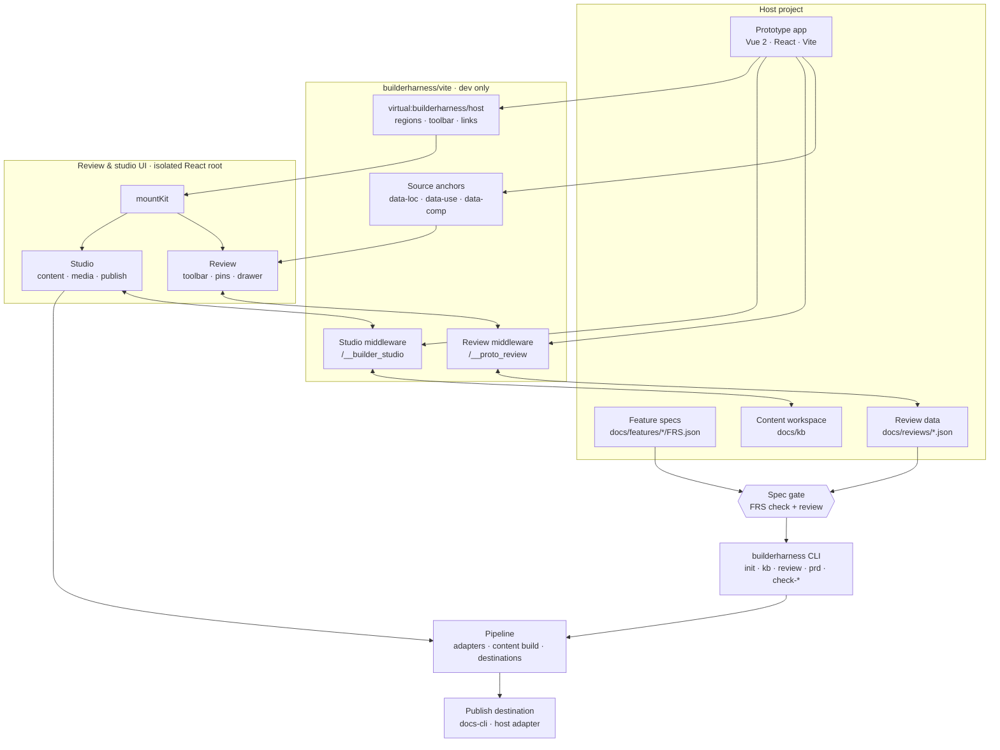

# BuilderHarness

**An agent harness for Product Builders.**

BuilderHarness is an agent harness for Product Builders. Day to day it keeps
Claude (and similar agents) on a leash: executable specs, a same-stack runnable
prototype as the source of truth, and human review before anything ships. The
result is production-minded frontends and fuller PRDs instead of vibecoding
toys — and because the artifacts stay linked after launch, release notes,
manuals and media fall out of the same source of truth.

**Spec-gated · prototype-as-truth · review before ship · production pieces plug in**

Auth, observability and deploy connect through mature providers:
**connecting ≠ bundling ≠ production-ready by default.**

[](./LICENSE)
[](https://nodejs.org/)

[中文文档](./README.zh-CN.md) · [Brand guide](./docs/brand.md)

## What it is

| Dimension | Definition |
|---|---|
| **User** | Product Builders — product × engineering × operations |
| **Category** | Agent harness: constrain the agent, run the loop, gate the result |
| **Job** | Build a maintainable product from 0→1, then keep changing, accepting and announcing it through 1→100 — the harness covers the gate, not the whole lifecycle |
| **Source of truth** | A same-stack runnable prototype plus specs (FRS, `frs:` / `code:` facts) |
| **Promise** | Fewer vibecoding toys; the spec becomes the unit of work; every change can go back through review |

The harness owns three things: **specs**, **the prototype as truth**, and **the
review gate**.

## The loop

```text
spec ──▶ same-stack prototype ──▶ review ──▶ gate ──▶ ship
  ▲             │                      │         │
  └── facts and changed claims ────────┴─────────┘
```

| Step | What happens | Where it lands |
|---|---|---|
| **Spec** | Requirements become machine-readable facts with ids an Agent can cite. | `docs/features/<KEY>/FRS.json` |
| **Prototype** | A real app in your own stack; the Agent reads source, routes, components and DOM state instead of guessing. | your Vite app (`web/`) |
| **Review** | Comments anchor to `file:line:column`, then degrade by component semantics and geometry, and report confidence. | `docs/reviews/<REGION>.json` |
| **Gate** | Comments resolve against the source; `check-frs` verifies the spec; preflight scans the production artifact before deploy. | `docs/reviews/`, preflight output |

The UI is React and lives in an isolated root under `<body>`. A thin host
adapter mounts it; the prototype keeps its own framework. **React is the primary
adapter**; a **Vue 2** adapter is optional. Writing an adapter for Vue 3 or
another framework is intentionally small (three responsibilities: layout slots,
router bridge, host controls).

The toolkit is **dev-only**. Production builds contain no BuilderHarness code
and no React.

## Architecture



The host app keeps its own stack. The toolkit enters through one Vite plugin,
mounts its React UI in an isolated root, and talks to the workspace through dev
middleware. The CLI and the UI share the same pipeline modules, so the terminal
and the browser cannot disagree. Nothing from this diagram ships in a
production build. See [docs/architecture.md](./docs/architecture.md) for the
details.

## What it is not

- **Not a CMS or a content factory.** Manuals, launch notes and media are
  downstream deliverables, not the product category.
- **Not a WordPress-like publishing tool or a generic AI writing assistant.**
  The Agent works against source, routes, specs and DOM state.
- **Not a Lovable / Bolt / v0 page generator.** Demo speed is not the promise;
  a maintainable repository and a review gate are.
- **Not a coding IDE or a hardening harness.** Cursor, Claude Code and DSH
  already write and isolate code well; BuilderHarness adds the spec gate and
  the Product Builder workflow around them.
- **Not a delivered auth / observability / deploy / SRE stack.** The harness
  owns gates and hooks; mature providers own the systems.
- **Not a gold label or a reward-model loop.** Passing the gate means the spec
  and the same-stack prototype agree — not that a model "won".

## Why this exists

Agent work breaks at both ends of the lifecycle. At the start, a prompt produces
a demo that cannot survive auth, payment, security, tests or observability. At
the end, nobody can tell which claims, documents and screenshots are still true
after the prototype changes.

A better prompt does not fix that. A harness does:

- **A spec an Agent can cite.** FRS entries have ids; prose facts reference
  `frs:` / `code:` sources; unresolved references fail the check.
- **A prototype that is the truth.** The Agent reads real source and real DOM.
  Review comments anchor back to `file:line:column`, so discussion stays on the
  artifact instead of in a chat log.
- **A gate before ship.** Upstream changes return claims to review; stale media
  is detected by content hash, not timestamp; preflight blocks dev endpoints,
  local paths and secrets in the production artifact.
- **Ownership stays with you.** The prototype is your stack and your repository.
  No hosted sandbox decides where the product can live.

The same constraints explain what is deliberately absent: the harness constrains
the process, it does not replace implementation. A full SRE or security
hardening program is still engineering delivery.

## What is in the box

- **Review** — select any element, leave a comment, persist it to disk; anchors
  degrade in three layers: source coordinates (L1), component semantics (L2),
  geometry (L3).
- **Specs and facts** — FRS templates and checks; `frs:` / `code:` fact
  references that reopen when upstream changes; `kb check` fails on broken
  references.
- **Agent context** — `kb context` and “copy for Agent” give an IDE Agent the
  page refs, recipes, requirements and source locations it needs.
  BuilderHarness does not run a hidden writing Agent.
- **Change detection** — stale screenshots and clips are decided by content
  hash and a rendered-pixel comparison, never by file age.
- **Preflight** — scan the production artifact before deploy or publish.
- **Host surfaces** — the same workspace works from the CLI, an MCP client
  (read-only), a DeepSeek Harness sidebar panel, or the bundled desktop shell.
- **Downstream deliverables** — after the gate, the same source can generate
  manuals, launch notes, message cards, screenshots and clips, and push them
  through a destination adapter. See [Downstream deliverables](#downstream-deliverables).

## Production pieces are integration points

Auth, observability, deployment and SRE are **integration points**, not bundled
features:

- the prototype runs on your own stack, in your own repository;
- adapters connect Cloudflare, GCP or an internal platform when the host needs
  them;
- **connecting ≠ bundling ≠ production-ready by default.** The adapter contract
  and provenance fields are the host's responsibility.

## Downstream deliverables

Once the review gate is in place, content is a side effect of the same source of
truth, not a second product:

| Output | What BuilderHarness contributes | Typical carrier |
| :-- | :-- | :-- |
| Operation manual / feature guide | Narrative + real screenshots + verified steps | Feishu Docs, Tencent Docs, wiki, site |
| Launch note / version update | Release facts + cover image + links | Docs, IM, email, internal feed |
| Message card | Title, fields, actions and source-backed copy | Feishu/Lark bot, WeCom, internal IM |
| Campaign / visual asset | Screenshots, GIFs, clips, cover images | Asset library, CDN, content platform |
| PRD / review report | FRS facts, review comments and generated structure | Docs, review archive |
| Content bundle | Blocks + assets + facts + metadata + review state | Any destination adapter |

Markdown remains the single source of truth for deliverables; there is no
parallel JSON copy of the content graph.

Details: [content model](./docs/content-model.md) and
[publishing destinations](./docs/publishing.md).

## Requirements

- Node.js >= 18
- Vite >= 5
- Vue 2.7 if you use the optional Vue 2 adapter and Vue source anchors
- React 18/19 if you use the React adapter (the toolkit already depends on React)
- Tailwind >= 4 if you use the canonical React components from `builderharness/ui`
- Less >= 3 if you use the bundled styles

## Install

```bash
npm install --save-dev builderharness
# peers, if the host does not already have them
npm install --save-dev vite less
# add the optional Vue 2 adapter peer only if the host uses it
npm install --save-dev vue@2.7
```

## Project layout

BuilderHarness reads and writes a small, conventional directory tree in the host project:

```text
my-prototype/
├── docs/
│   ├── templates/                   # FRS / FLOW / STATE / ACCEPTANCE templates
│   ├── WORKFLOW.md                  # requirement → FRS → prototype → review gate → deliverables → publish
│   ├── features/<KEY>/FRS.json      # feature specs (optional)
│   ├── kb/
│   │   ├── outline.config.mjs       # content outline
│   │   ├── shots.config.mjs         # screenshot recipes
│   │   ├── clips.config.mjs         # clip recipes
│   │   └── *.md                     # content, the source of truth
│   ├── prd/                         # generated PRDs
│   └── reviews/                     # review comments (generated)
├── web/                             # your prototype app (configurable)
│   └── src/
├── .agent/skills/                   # requirement / PRD / content / review skills
└── package.json
```

The project root is detected by walking up from the current working directory to the nearest ancestor containing `docs/`, a `builderharness.config.*` file, or a `package.json` that depends on `builderharness`. Override it with `BUILDERHARNESS_ROOT`.

## Quick start

### 0. Initialize a new workspace

```bash
cd my-prototype
npx builderharness init
# preview first: npx builderharness init --list
# overwrite generated files: npx builderharness init --force
```

This copies `docs/templates/`, `docs/WORKFLOW.md`, `docs/kb/CONTRIBUTING.md`,
starter kb configurations, `src/config/frs-map.js`, `AGENTS.md` / `CLAUDE.md`
and the core `.agent/skills/` into the host project. Existing files are kept
unless `--force` is passed. Then run:

```bash
npx builderharness kb-scaffold
```

### 1. Add the Vite plugin

```js
// web/vite.config.js
import { fileURLToPath, URL } from "node:url";
import { defineConfig } from "vite";
import vue from "@vitejs/plugin-vue2";
import { builderHarness } from "builderharness/vite";

const root = fileURLToPath(new URL(".", import.meta.url));

export default defineConfig({
  plugins: [
    builderHarness({
      root,
      // optional: requirement-region registry (business data)
      frsRegistry: "src/config/frs-map.js",
      // optional: host controls injected into the review toolbar
      barExtras: ["src/components/common/ThemeToggle.vue"],
      // optional: host links on the right side of the toolbar
      barLinks: [{ label: "Design system", route: { name: "design-system" } }],
      // optional: prefix for “copy for Agent” prompts
      agentPrompt: "",
    }),
    vue(), // builderHarness's anchor plugin runs before this
  ],
});
```

`builderHarness()` registers four things:

1. `build/anchor-loc.js` — dev-time source-coordinate injection.
2. `server/review-server.js` — dev middleware that persists comments.
3. `server/studio-server.js` — dev middleware for the content workspace.
4. `client/` — the React UI, exposed through the host adapter.

### 2. Mount the UI

Vue 2 example (the adapter is exported from `builderharness/vue2`):

```js
// App.vue
export default {
  data: () => ({ kitRoot: null }),
  mounted() {
    if (import.meta.env.DEV) {
      import("builderharness/vue2").then((m) => {
        this.kitRoot = m.BuilderHarnessRoot;
      });
    }
  },
};
```

```vue
<template>
  <component :is="kitRoot" v-if="kitRoot">
    <router-view />
  </component>
  <router-view v-else />
</template>
```

`import.meta.env.DEV` is replaced with `false` at build time, so the dynamic import and the whole toolkit branch disappear from production.

React example (the adapter is exported from `builderharness/react`):

```jsx
// main.jsx
import { createRoot } from "react-dom/client";
import App from "./App.jsx";
import { hashRouter } from "builderharness/react";

const root = createRoot(document.getElementById("root"));

if (import.meta.env.DEV) {
  import("builderharness/react").then(({ BuilderHarnessRoot }) => {
    root.render(
      <BuilderHarnessRoot router={hashRouter()}>
        <App />
      </BuilderHarnessRoot>,
    );
  });
} else {
  root.render(<App />);
}
```

`hashRouter()` is a small built-in bridge; a router-library adapter can pass its
own `{ current, subscribe, href, push }` object instead.

For another framework, create an adapter that calls `mountKit` and provides the slots described in [`client/core/host.js`](./client/core/host.js). See [docs/adapters.md](./docs/adapters.md).

### 3. Provide design tokens

The bundled Less files use semantic variables such as `@color-primary`, `@color-border` and `@space-8`. If the host already injects its own tokens, no action is needed.

If you do not have a design-token sheet, import the neutral defaults:

```js
// vite.config.js
import { createRequire } from "node:module";
import path from "node:path";

const require = createRequire(import.meta.url);
const kitRoot = path.dirname(require.resolve("builderharness/package.json"));
const themeDefaults = path.join(kitRoot, "client/core/theme-defaults.less");

export default defineConfig({
  css: {
    preprocessorOptions: {
      less: {
        additionalData: `@import "${themeDefaults}";`,
      },
    },
  },
});
```

The defaults are CSS variables with fallbacks, so the palette can be changed at runtime:

```css
:root {
  --bk-color-primary: #1677ff;
}
```

See [docs/styling.md](./docs/styling.md).

### 4. Optional: use the UI spec components

The repository includes the **Tool UI Spec** under [`ui-spec/`](./ui-spec):
tokens, Tailwind config, and canonical React components.

```jsx
import { Badge, Button, Card, Dialog, EmptyState, SegmentedControl, Table } from "builderharness/ui";
import "builderharness/tokens.css";
```

See [docs/ui-spec.md](./docs/ui-spec.md) for the token pipeline, the Less bridge
and the conformance check.

## Studio: deliverables downstream of the gate

The studio is optional. It exists after the loop above, not instead of it: a
manual or launch note should be able to cite the same spec and prototype that
were reviewed. It keeps the source, facts, media recipes, review state and
publishing metadata together:

| Layer | What it means | Where it lives |
| :-- | :-- | :-- |
| Narrative | The source of truth for manuals, notices, cards and campaign copy | `docs/kb/*.md` |
| Facts | Claims tied to `frs:` requirements or `code:` source; open when upstream changes | `<!--f …-->` references and `docs/kb/_lock.json` |
| Media | Screenshots, GIFs and clips generated from reproducible recipes | `docs/kb/shots.config.mjs`, `clips.config.mjs`, `images/`, `media/` |
| Structure | Sections, intents and planned slots that the Agent fills | `<!--intent …-->`, `<!--slot …-->` and page front-matter |
| Publication | Plan, confirmation, external ids, URLs and fingerprints | `docs/kb/_published.json` and destination adapter state |

The deliverable loop is:

1. An Agent reads the prototype source, routes, FRS and DOM; it uses
   `kb context` and the copied commands to produce accurate copy.
2. Chrome/CDP and ffmpeg build screenshots, GIFs and clips from recipes instead
   of manual attachments.
3. The studio shows what changed, compares media before/after and asks a human
   to confirm the few claims that need judgment.
4. The destination layer publishes the same content bundle as a manual, notice,
   message card or asset set.

Long-form content is implemented end-to-end today. Message cards and asset
libraries use the same destination layer; the adapter exposes resource-level
methods for those carriers instead of forcing them into Markdown.

BuilderHarness does **not** run a hidden writing Agent. It makes the IDE Agent
precise by supplying source context, executable media recipes, freshness checks
and a human review gate.

## Demo

[`examples/react-tailwind`](./examples/react-tailwind) is a synthetic React +
Tailwind product workspace that exercises the toolkit end to end.

| Light | Dark |
|---|---|
|  |  |


```bash
npm run demo        # dev server, usually http://localhost:5173/#/overview
npm run build:demo  # production build
```

It includes source-anchored review comments, the content-check queue with
before/after media, an Agent-ready command palette, an async dialog with retry,
dark mode, a publishing panel and a full UI spec page with foundations, live
component states, patterns, accessibility notes and a searchable token
reference. Every value comes from the same tokens as the toolkit UI.

## Agent host integration: DeepSeek Harness + MCP

[`integrations/`](./integrations) runs BuilderHarness beside an agent runtime:

- [`integrations/host`](./integrations/host) — `@builderharness/dsh-bundle`, with a
  DeepSeek Harness plugin, a right-sidebar BuilderHarness panel, review write tools
  and a `builderharness-mcp` stdio entrypoint for Cursor, Claude, Codex or another MCP
  client.
- [`integrations/desktop`](./integrations/desktop) — a branded Electron shell
  that boots an upstream dsh profile and loads the Web UI; no kernel fork. Its
  first screen is a BuilderHarness launcher for importing an existing project,
  creating a scaffolded one, or reopening a recent workspace. The workbench uses
  a thin project picker that opens the DSH workspace directly. BuilderHarness
  registers six domain tabs in DSH's own right sidebar (baseline, requirements,
  prototype, review, content and publish) and reuses DSH's files, browser and
  terminal tabs instead of shipping a parallel workbench. The cockpit opens as
  DSH's main panel, follows the session you are looking at, and finds the real
  dev server even when the app lives in `web/`, `app/` or `apps/*`; if its
  dependencies are missing it installs them with the repo's own package manager
  before embedding the running prototype.
- All faces share the same dependency-free workspace reader, so the project
  files stay the contract.

```bash
npm run test:integrations
```

The dsh plugin can inspect a workspace, list content and reviews, add and
resolve comments, read/confirm the content lock, show the publish plan, and
rebuild screenshots or clips with the reproducible recipe runner. The same
capabilities are exposed through the `ctx.builderharness` service; MCP stays
read-only.


See [integrations/README.md](./integrations/README.md).

## Pre-deploy check

Publishing is an outbound action. Scan the production artifact first:

```bash
npm run build
node scripts/preflight-dist.mjs --dir dist
node scripts/preflight-dist.mjs --dir dist --deny "corp\\.example\\.com"
```

It fails on dev endpoints, source anchors, review data paths, absolute home
paths, localhost URLs, source maps, private keys and common credential patterns.
See [docs/deploy-skill-review.md](./docs/deploy-skill-review.md) for the
new-environment detection review of a Harness deploy skill. The review is
reproducible with an isolated E2E harness (fake CLI, registry, fetch and HOME):

```bash
DEPLOY_SKILL=/path/to/deploy.mjs npm run test:deploy-skill
```

## Configuration

```js
builderHarness({
  root,                 // host app root (default: process.cwd())
  frsRegistry,          // module exporting FRS_REGISTRY, relative to root
  barExtras: [],        // host components rendered in the review toolbar
  barLinks: [],         // [{ label, route, title? }]
  reviewsDir,           // default: <project>/docs/reviews
  anchorLoc: true,      // set false for non-Vue prototypes
  agentPrompt: "",      // prompt prefix for “copy for Agent” buttons
})
```

Environment variables:

| Variable | Meaning | Default |
|---|---|---|
| `BUILDERHARNESS_ROOT` | Host project root | auto-detected |
| `BUILDERHARNESS_DOCS_DIR` | Docs directory, relative to project root | `docs` |
| `BUILDERHARNESS_WEB_DIR` | Prototype app directory, relative to project root | `web` if present, else project root |
| `BUILDERHARNESS_ADAPTER` | Pipeline adapter name | `vue2-vite` |
| `BUILDERHARNESS_PUBLISH_GATEWAY` | Publish destination adapter: path, `file:` URL, or package name | not configured |
| `BUILDERHARNESS_DOCS_CLI` | Command prefix used by the bundled `docs-cli` adapter | `docs-cli` |

## CLI

The package installs one dispatcher: `builderharness`.

```bash
npx builderharness kb status
npx builderharness kb context docs/kb/guides/import.md
npx builderharness kb shoot --stale
npx builderharness kb ack guides/import.md
npx builderharness review open
npx builderharness review resolve <comment-id> --note "Changed to secondary style"
npx builderharness export-review-notes --status open
npx builderharness prd MY_FEATURE --scope delta
npx builderharness check-frs
```

Run `npx builderharness --help` for the full list. The scripts under [`pipeline/`](./pipeline) can also be executed directly with `node`.

The `check-ui`, `check-routes` and `check-frs` scripts are **reference host checks**: they encode one design-system convention (iView components, a specific token file, a navigation registry). Adapt or remove them for your project. Everything else is framework-agnostic.

## Publishing

Publishing is optional. BuilderHarness owns the content bundle, plan/confirm,
resumable state and the studio UI. The **destination** is an adapter owned by
the host. A destination is a delivery edge for downstream deliverables, not a
production stack:

```bash
BUILDERHARNESS_PUBLISH_GATEWAY=./tools/publish-gateway.mjs npx builderharness kb-publish --dry-run
```

A destination can publish to Feishu Docs, Tencent Docs, an internal wiki/CMS,
an IM bot, or another content platform. The payload is not limited to long-form
documents: manuals, launch notes, message cards, screenshots, GIFs and clips
can share the same integration layer. The contract and examples are in
[`docs/publishing.md`](./docs/publishing.md). Publishing is disabled until a
destination is configured. To use the bundled
[`docs-cli` reference destination](./pipeline/destinations/docs-cli.mjs), set
`BUILDERHARNESS_PUBLISH_GATEWAY=docs-cli` (it still accepts a CLI command prefix
through `BUILDERHARNESS_DOCS_CLI`). Local review, content status, screenshots
and clips work without any destination at all.

## Development

```bash
npm install
npm run check
npm run test:publish-gateway
```

`npm run check` syntax-checks every `.js`/`.mjs` file, imports the path resolver, exercises the CLI help path, runs the UI spec gate, and verifies that every manifest and lockfile entry resolves from `https://registry.npmjs.org`. The repository pins that registry in `.npmrc`, so a global or proxy registry cannot silently change what is installed.

## Design notes

- [Architecture and anchors](./docs/architecture.md)
- [Project scaffold and templates](./scaffold/README.md)
- [Host and pipeline adapters](./docs/adapters.md)
- [Content model](./docs/content-model.md)
- [Styling and tokens](./docs/styling.md)
- [UI spec integration](./docs/ui-spec.md)
- [Content destinations](./docs/publishing.md)
- [Deploy skill review](./docs/deploy-skill-review.md)

## License

[MIT](./LICENSE)
