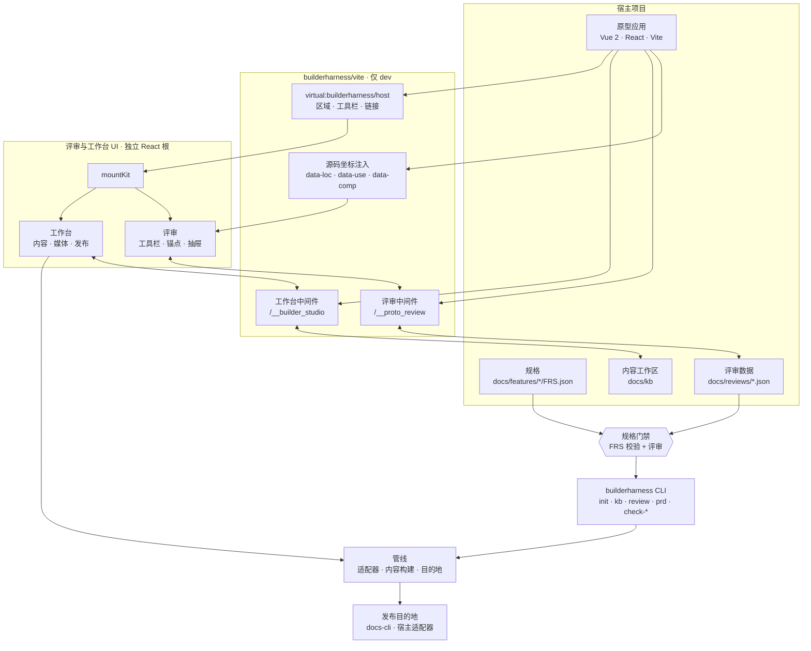
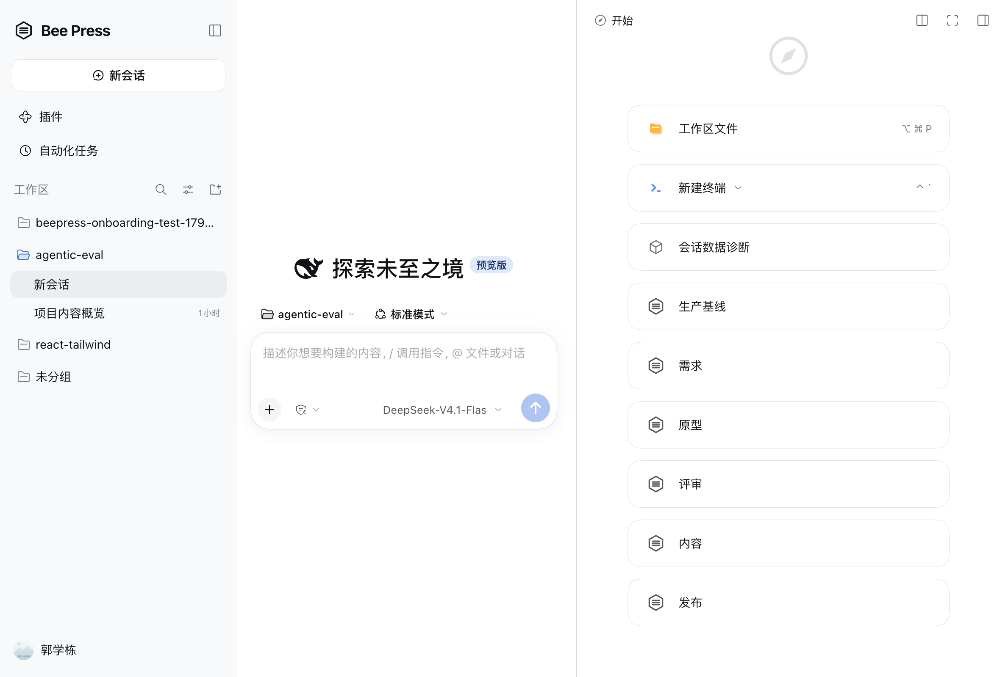

# BuilderHarness

**Product Builder 的 Agent Harness。**

BuilderHarness 是给 Product Builder 用的 Agent Harness。日常配合 Claude（以及同类 Agent），把它拴在可执行规格与同源可跑原型上，评审放行之后才允许 ship：产出更专业的前端与更完整的 PRD，而不是 vibecoding 玩具页。上线之后，发布说明、手册与素材仍然从同一个事实源派生。

**规格门禁 · 同源原型即真相 · 回审放行 · 生产件可插拔**

auth、观测与部署通过成熟设施对接：
**对接 ≠ 内置 ≠ 装上即生产就绪。**

[](./LICENSE)
[](https://nodejs.org/)

[English](./README.md) · [品牌说明](./docs/brand.md)

## 它是什么

| 维度 | 定义 |
|---|---|
| **用户** | 互联网 Product Builder —— 产品 × 技术 × 运营 |
| **品类** | Agent Harness：约束 Agent、跑完环、门禁结果 |
| **场景** | 0→1 做出可维护的产品；1→100 持续修改、验收、宣贯——Harness 覆盖门禁，不代管整条生命周期 |
| **真相源** | 同源可跑原型 + 规格（FRS、`frs:` / `code:` 事实） |
| **承诺** | 少出 vibecoding 玩具页；规格成为工作单元；每次改动都能回审 |

Harness 只管三件事：**规格**、**同源原型即真相**、**评审门禁**。

## 跑环

```text
规格 ──▶ 同源可跑原型 ──▶ 评审 ──▶ 门禁 ──▶ ship
  ▲             │                    │         │
  └── 事实与变更回审 ───────────────┴─────────┘
```

| 环节 | 发生什么 | 落到哪 |
|---|---|---|
| **规格** | 需求变成可被 Agent 引用的机器可读事实，带 id。 | `docs/features/<KEY>/FRS.json` |
| **原型** | 跑在你自己技术栈里的真实应用；Agent 读源码、路由、组件和 DOM，不靠猜。 | 你的 Vite 应用（`web/`） |
| **评审** | 批注锚到 `file:line:column`，失效时按组件语义、几何位置降级，并报告置信度。 | `docs/reviews/<区域>.json` |
| **门禁** | 批注按源码坐标闭环；`check-frs` 校验规格；preflight 在部署前扫描生产产物。 | `docs/reviews/`、preflight 输出 |

界面是 **React**，挂在 `<body>` 下独立的根上；原型保持自己的框架，不用装 React。**React 是主适配层**（`builderharness/react`）；**Vue 2**（`builderharness/vue2`）是可选的兼容适配层。换框架只需按 `client/core/host.js` 写一层很薄的适配。

套件**只在 dev 生效**：入口组件的 `import.meta.env.DEV` 动态 import 在生产构建期被消除，产物里不留任何套件代码。

## 架构



宿主应用保持自己的技术栈；套件通过一个 Vite 插件接入，把 React UI 挂到独立根上，并通过 dev 中间件读写工作区。CLI 与 UI 复用同一套管线模块，终端和浏览器不会给出不同结论。这张图里的任何部分都不会进入生产构建。更多细节见[架构说明](./docs/architecture.md)。

## 它不是什么

- **不是 CMS，也不是内容工厂。** 手册、上线通知、素材是下游交付物，不是品类。
- **不是 WordPress 式发布工具，也不是通用 AI 写作助手。** Agent 对着源码、路由、规格和 DOM 工作。
- **不是 Lovable / Bolt / v0 式一键出页器。** 承诺的不是 demo 速度，而是可维护的仓库和评审门禁。
- **不是纯 coding IDE，也不是 hardening harness。** Cursor / Claude Code / DSH 已经把写代码和隔离验证做得很好；BuilderHarness 补的是规格门禁与 Product Builder 的工作流。
- **不是已交付的 auth / 观测 / 部署 / SRE 栈。** Harness 管门禁与钩子，系统本身归成熟设施。
- **不是金标 / 奖励模型闭环。** 过闸只代表规格与同源原型一致，不代表模型“赢了”。

## 为什么需要它

Agent 的活坏在生命周期两头。开始阶段，一句 prompt 出来的 demo 经不起 auth、支付、安全、测试和可观测；结束阶段，原型一改，没人说得清哪些断言、文档和截图还成立。

更好的 prompt 解决不了，得靠 Harness：

- **规格可被引用。** FRS 条目有 id；正文事实引用 `frs:` / `code:` 来源；引用断掉就直接失败。
- **原型就是真相。** Agent 读真实源码和真实 DOM；批注锚回 `file:line:column`，讨论留在工件上，而不是聊天记录里。
- **上线前有门禁。** 上游变化把断言送回评审；陈旧媒体按内容哈希判定，不看时间；preflight 拦截开发接口、本机路径和密钥。
- **所有权在你手里。** 原型是你的技术栈、你的仓库；没有托管沙箱决定产品能长在哪。

这也解释了哪些东西是故意不做的：Harness 约束流程，不替代实现。完整的 SRE 或安全加固，仍然是一笔工程交付。

## 盒子里有什么

- **Review** —— 圈选元素、写批注、落盘；三层锚点：源码坐标（L1）、组件语义（L2）、几何位置（L3）。
- **规格与事实** —— FRS 模板与校验；`frs:` / `code:` 事实在上游变化时回到待确认；`kb check` 遇到断引用直接失败。
- **Agent 上下文** —— `kb context` 与「复制给 Agent」把页面引用、媒体配方、规格和源码位置交给 IDE 里的 Agent；BuilderHarness 不跑隐藏的写作 Agent。
- **变更检测** —— 截图/录屏是否过期按内容哈希与画面比对判定，不看文件时间。
- **Preflight** —— 部署或发布之前扫描生产产物。
- **宿主入口** —— 同一份工作区可用于 CLI、只读 MCP 客户端、DeepSeek Harness 右侧栏面板，以及随包的桌面壳。
- **下游交付物** —— 过闸之后，同一事实源还能生成手册、上线通知、消息卡片、截图与录屏，并通过目的地适配器投递。见[下游交付物](#下游交付物)。

## 生产件是对接点

auth、观测、部署与 SRE 是**对接点**，不是内置能力：

- 原型跑在你自己的技术栈和仓库里；
- 需要时用适配器接 Cloudflare、GCP 或内部平台；
- **对接 ≠ 内置 ≠ 装上即生产就绪。** 适配器契约与 provenance 字段由宿主负责。

## 下游交付物

评审门禁就位之后，内容是同一事实源上的副作用，不是第二个产品：

| 产出 | BuilderHarness 提供什么 | 典型载体 |
| :-- | :-- | :-- |
| 操作手册 / 功能说明 | 正文 + 真实截图 + 可核对步骤 | 飞书文档、腾讯文档、Wiki、站点 |
| 上线通知 / 版本更新 | 发布事实 + 封面 + 跳转链接 | 文档、IM、邮件、内部信息流 |
| 消息卡片 | 标题、字段、动作和可追溯文案 | 飞书/企微机器人、内部 IM |
| 宣传 / 视觉物料 | 截图、GIF、录屏、封面图 | 素材库、CDN、内容平台 |
| PRD / 评审报告 | FRS 事实、评审意见和生成结构 | 文档、评审归档 |
| 内容 Bundle | 正文 + 资产 + 事实 + 元数据 + 评审状态 | 任意目的地适配器 |

交付物仍以 Markdown 为唯一真源，不另存一份内容 JSON。

细节见[内容模型](./docs/content-model.md)与[发布目的地](./docs/publishing.zh-CN.md)。

## 为什么单独一层

原型是产品资产，随业务演进、要整份交付研发；套件是跨原型复用的能力，生命周期完全不同。把套件寄居在原型源码里，后果是「删掉工具层还得动产品代码」。BuilderHarness 把两者的边界收敛成宿主工程里的两行配置。

## 做工具时的几条判断

- **一个事实只有一份真源，派生的不存。** 构成视图全由正文算出来，改结构就是改 md。
- **机制不暴露成功能。** 用户要学的只有问题本身的名词（原型页面、截图录屏、内容资源），节点类型、任务状态是实现。
- **失败要响。** 产物生成了、流程绿灯、内容却是错的，是最坏的失败；判据要显式。
- **按内容判断变没变，不按时间。** 源码哈希、画面比对决定要不要重拍、重发。
- **Agent 可以读源码、看页面、调用媒体工具；落盘与核对由管线负责，人的判断不替人做。**

## 安装

```bash
npm install --save-dev builderharness
# 宿主还没有这些 peer 时
npm install --save-dev vite less
# 仅当宿主使用可选 Vue 2 适配层时
npm install --save-dev vue@2.7
```

要求：Node.js >= 18、Vite >= 5、Vue 2.7（可选，仅使用 Vue 2 适配层与 Vue 源码坐标注入时）、React 18/19（使用 React 适配层时，套件自身已依赖 React）、Tailwind >= 4（使用 `builderharness/ui` 的规范组件时）、Less >= 3（使用自带样式时）。

## 目录约定

```text
my-prototype/
├── docs/
│   ├── templates/                   # FRS / FLOW / STATE / ACCEPTANCE 模板
│   ├── WORKFLOW.md                  # 需求 → FRS → 原型 → 评审放行 → 交付物 → 发布
│   ├── features/<KEY>/FRS.json      # 需求件套（可选）
│   ├── kb/
│   │   ├── outline.config.mjs       # 内容大纲
│   │   ├── shots.config.mjs         # 截图配方
│   │   ├── clips.config.mjs         # 录屏配方
│   │   └── *.md                     # 正文，唯一真源
│   ├── prd/                         # 生成的 PRD
│   └── reviews/                     # 批注（生成）
├── web/                             # 原型工程（可用 BUILDERHARNESS_WEB_DIR 改）
│   └── src/
├── .agent/skills/                   # 需求 / PRD / 内容 / 评审技能
└── package.json
```

项目根从当前工作目录向上找：最近的包含 `docs/`、`builderharness.config.*`，或 `package.json` 依赖 `builderharness` 的目录。也可以用 `BUILDERHARNESS_ROOT` 显式指定。

## 接入

### 0. 初始化新工程

```bash
cd my-prototype
npx builderharness init
# 先看会复制什么：npx builderharness init --list
# 覆盖已生成的文件：npx builderharness init --force
```

会把 `docs/templates/`、`docs/WORKFLOW.md`、`docs/kb/CONTRIBUTING.md`、
知识库配置骨架、`src/config/frs-map.js`、`AGENTS.md` / `CLAUDE.md` 和核心
`.agent/skills/` 复制到宿主项目。已存在的文件默认保留，只有 `--force` 才覆盖。
然后运行：

```bash
npx builderharness kb-scaffold
```

### 1. 宿主 `vite.config.js`

```js
import { fileURLToPath, URL } from "node:url";
import { defineConfig } from "vite";
import vue from "@vitejs/plugin-vue2";
import { builderHarness } from "builderharness/vite";

const root = fileURLToPath(new URL(".", import.meta.url));

export default defineConfig({
  plugins: [
    builderHarness({
      root,
      frsRegistry: "src/config/frs-map.js",   // 需求区域注册表（业务数据）
      barExtras: ["src/components/common/ThemeToggle.vue"], // 注入工具栏的宿主控件
      barLinks: [{ label: "设计规范", route: { name: "design-system" } }],
      agentPrompt: "",                        // “复制给 Agent”的指令前缀
    }),
    vue(),   // builderHarness 内的 anchor-loc 必须先拿到原始 SFC
  ],
});
```

### 2. 挂载 UI（Vue 2 / React）

```js
// App.vue
export default {
  data: () => ({ kitRoot: null }),
  mounted() {
    if (import.meta.env.DEV) {
      import("builderharness/vue2").then((m) => { this.kitRoot = m.BuilderHarnessRoot; });
    }
  },
};
```

```vue
<template>
  <component :is="kitRoot" v-if="kitRoot">
    <router-view />
  </component>
  <router-view v-else />
</template>
```

React 原型用 `builderharness/react`：

```jsx
// main.jsx
import { createRoot } from "react-dom/client";
import App from "./App.jsx";
import { hashRouter } from "builderharness/react";

const root = createRoot(document.getElementById("root"));

if (import.meta.env.DEV) {
  import("builderharness/react").then(({ BuilderHarnessRoot }) => {
    root.render(
      <BuilderHarnessRoot router={hashRouter()}>
        <App />
      </BuilderHarnessRoot>,
    );
  });
} else {
  root.render(<App />);
}
```

这两处就是全部集成缝。删掉它们即可剥离整个工具层，生产产物里不留任何痕迹。

### 3. 设计 Token

自带样式使用 `@color-primary`、`@color-border`、`@space-8` 这类语义变量。宿主已有 token 注入时不用管；没有时引入中性默认值：

```js
import { createRequire } from "node:module";
import path from "node:path";

const require = createRequire(import.meta.url);
const kitRoot = path.dirname(require.resolve("builderharness/package.json"));
const themeDefaults = path.join(kitRoot, "client/core/theme-defaults.less");

export default defineConfig({
  css: {
    preprocessorOptions: {
      less: { additionalData: `@import "${themeDefaults}";` },
    },
  },
});
```

默认值是带 fallback 的 CSS 变量，运行时可以改：

```css
:root { --bk-color-primary: #1677ff; }
```

详见 [docs/styling.md](./docs/styling.md)。

### 4. 使用 UI 规范组件（可选）

仓库内置 **Tool UI Spec**（[`ui-spec/`](./ui-spec)）：令牌、Tailwind 配置与 React 参考组件。

```jsx
import { Badge, Button, Card, Dialog, EmptyState, SegmentedControl, Table } from "builderharness/ui";
import "builderharness/tokens.css";
```

令牌管线、Less 桥接与门禁见 [docs/ui-spec.md](./docs/ui-spec.md)。

## 演示原型

[`examples/react-tailwind`](./examples/react-tailwind) 是一个 React + Tailwind 的合成产品原型，完整跑通套件。

| 浅色 | 深色 |
|---|---|
|  |  |


```bash
npm run demo        # 开发服务，默认 http://localhost:5173/#/overview
npm run build:demo  # 生产构建
```

包含源码坐标批注、内容检查队列、截图前后对比、Agent 上下文与指令、IME 守卫的命令面板、带重试的异步弹窗、深色模式、发布面板，以及完整的 UI 规范页：基础令牌、组件实时状态、组合模式、无障碍说明和可搜索的 Token 表。所有视觉值都来自与套件相同的令牌。

## Agent Host 集成：DeepSeek Harness + MCP

[`integrations/`](./integrations) 把 BuilderHarness 接到 Agent runtime 上：

- [`integrations/host`](./integrations/host) — `@builderharness/dsh-bundle`，包含 DeepSeek Harness 插件、右侧栏 BuilderHarness 面板、评论写工具，以及 `builderharness-mcp` stdio 入口，可接 Cursor、Claude、Codex 或其他 MCP 客户端。
- [`integrations/desktop`](./integrations/desktop) — 品牌化薄 Electron 壳，启动上游 dsh profile 并加载 Web UI，不 fork 内核。首屏是 BuilderHarness 启动器：导入已有项目、新建脚手架项目，或打开最近工作区。桌面端只保留一个薄项目选择器，选中后直接进入 DSH 工作区。BuilderHarness 通过 DSH 自己的右侧栏注册六个领域标签（生产基线、需求、原型、评审、内容、发布），文件、浏览器和终端直接复用 DSH 自带标签，不再维护平行工作台。操作台就是 DSH 主面板，跟随你当前查看的会话；即使 dev server 在 `web/`、`app/` 或 `apps/*` 也能定位，依赖缺失时会用项目自己的包管理器先安装，再把运行中的原型嵌进来。
- 所有入口共用同一个无依赖的工作区读取器，项目文件仍是契约。

```bash
npm run test:integrations
```

dsh 插件可以检查工作区、列出内容与评论、新增并解决评论、读取/确认内容锁、查看发布计划，并用可复现的配方重建截图或录屏。同一组能力通过 `ctx.builderharness` 服务暴露；MCP 仍只读。



详见 [integrations/README.md](./integrations/README.md)。

## 发布前检查

发布是对外动作，先扫产物：

```bash
npm run build
node scripts/preflight-dist.mjs --dir dist
node scripts/preflight-dist.mjs --dir dist --deny "corp\\.example\\.com"
```

会拦截开发接口、源码坐标、批注数据路径、本机绝对路径、localhost、source map、私钥与常见凭据。Harness 部署 skill 在新环境下的检测机制与引导建议见 [docs/deploy-skill-review.md](./docs/deploy-skill-review.md)；该评审附隔离式端到端测试（假 CLI、假 registry、假 fetch、临时 HOME）：

```bash
DEPLOY_SKILL=/path/to/deploy.mjs npm run test:deploy-skill
```

## 配置

```js
builderHarness({
  root,                 // 宿主应用根，默认 process.cwd()
  frsRegistry,          // 导出 FRS_REGISTRY 的模块，相对 root
  barExtras: [],        // 注入评审工具栏的宿主组件
  barLinks: [],         // [{ label, route, title? }]
  reviewsDir,           // 批注目录，默认 <项目根>/docs/reviews
  anchorLoc: true,      // 非 Vue 原型设为 false
  agentPrompt: "",      // “复制给 Agent”的指令前缀
})
```

环境变量：

| 变量 | 含义 | 默认 |
|---|---|---|
| `BUILDERHARNESS_ROOT` | 宿主项目根 | 自动探测 |
| `BUILDERHARNESS_DOCS_DIR` | 文档目录，相对项目根 | `docs` |
| `BUILDERHARNESS_WEB_DIR` | 原型工程目录，相对项目根 | 有 `web/` 用 `web`，否则项目根 |
| `BUILDERHARNESS_ADAPTER` | 管线适配器名 | `vue2-vite` |
| `BUILDERHARNESS_PUBLISH_GATEWAY` | 发布目标适配器：路径、`file:` URL 或包名 | 未配置 |
| `BUILDERHARNESS_DOCS_CLI` | 内置 `docs-cli` 适配器的命令前缀 | `docs-cli` |

## 工作台：门禁之后的下游交付

工作台是可选的。它位于上面那个环之后，而不是替代它：一份手册或上线通知，应该能引用刚刚评审过的同一份规格与原型。**这条链路是一个内容构建系统。** 叙述由 Agent 或人写成源文件，截图录屏是按配方可复现的构建产物，事实是被校验的断言；「上游变了之后，这几句还成立吗」是唯一需要人判断的事。

| 概念 | 在哪 | 谁维护 |
|---|---|---|
| 叙述 | `docs/kb/*.md`，唯一真源 | Agent 或人，在编辑器里写 |
| 截图 / 录屏 | `docs/kb/shots.config.mjs` / `clips.config.mjs` 的配方 → `images/` `media/` | 管线重拍，台账 `_media.json` 记源码快照与产物哈希 |
| 事实 | 正文里 `<!--f 依据-->原文<!--/f-->`，依据是 `frs:` / `code:` / `note:` | 写的人标；`frs:` 对照需求规格原文，`code:` 对照原型源码，`note:` 验不了 |
| 锁 | `docs/kb/_lock.json`：每页检查过时每条引用的值 | 人点「确认这处」或 `kb ack` |
| 蓝图 | 正文里 `<!--intent …-->` 与 `<!--slot 类型 @路由 说明-->`，front-matter 的 `topic` / `type` / `pages` | Agent 提议、人在构成视图里调；发布时剥掉 |

**早截断。** 页面源码变了 → 物料该重拍（按依赖闭包的内容哈希判，不看修改时间）；重拍之后画面没变 → 到此为止，不打扰任何文档。「画面没变」按 16×16 格比灰度，差异格不超过 8 个算没变；高倍截图里一条边线挪 1 个 CSS 像素会碰几百个格子，这类差异再逐像素核一遍。

**内容工作台只做三件事：摆出来、记下确认、交给发布目的地。** 入口在评审工具栏的「内容」，整屏打开：

- 顶栏的「内容」下拉是生产出来的全部篇目，带「几处待确认 / 迭代中 / 几处待补充 / 不发布」标记。
- 文档页把「待确认 N 处」排在上面：截图并排「上次确认时」与「现在」，图下逐条写出变了什么。
- 构成视图是同一份 md 的另一种看法：来源 → 素材与事实 → 章节，画布可缩放、可筛选、可折叠。
- 发布是把选中的长文/物料交给宿主配置的载体；目的地适配器负责飞书、腾讯文档、内部平台、IM 等差异。

当前长文内容已经端到端跑通；消息卡片、素材库等载体复用同一发布层，由适配器暴露资源级方法，不把卡片硬塞成 Markdown。

**要 Agent 写的活交给 IDE 里的 Agent。** 内容工作台不起后台写作 Agent：按钮都是「复制给 Agent」，复制一条指令，粘到 IDE 里的 Agent 对话。`agentPrompt` 可配置指令前缀。

## 命令行

安装后提供统一入口：`builderharness`。

```bash
npx builderharness kb status            # 哪些内容待确认、哪些图该重拍
npx builderharness kb context <页|路由>  # 给 Agent：引用、可用媒体配方、可引的规格原文
npx builderharness kb shoot --stale     # 只重拍源码真变了的
npx builderharness kb ack <页> [<id>…]  # 我看过了
npx builderharness kb where <配方|路由|依据> # 谁在引用它
npx builderharness kb check             # 引用断了才失败，要审只提醒
npx builderharness kb new <页> <类型> "<话题>" --pages=/a,/b
npx builderharness review open          # 未解决的批注，带源码坐标
npx builderharness review resolve <id…> --note "…"
npx builderharness export-review-notes --status open
npx builderharness prd <KEY> --scope delta
```

完整列表见 `npx builderharness --help`。`pipeline/` 下的脚本也可以直接用 `node` 运行。

`check-ui` / `check-routes` / `check-frs` 是**宿主符合性检查的参考实现**，写死了一套设计体系约定（iView 组件、token 文件、导航登记）。换产品时照抄约定或改这三份脚本；其余能力与框架无关。

## 发布

发布是可选的，属于下游交付物的投递边界。BuilderHarness 只提供核心流程——内容 bundle、计划确认、可续跑状态和内容工作台 UI；**投递到哪个载体**由宿主自己的适配器决定：

```bash
BUILDERHARNESS_PUBLISH_GATEWAY=./tools/publish-gateway.mjs npx builderharness kb-publish --dry-run
```

适配器可以接飞书文档、腾讯文档、内部 Wiki/CMS、IM 机器人等内容平台。发布物不只长文：操作手册、上线通知、消息卡片、截图/录屏/GIF/视频都可以走同一个接入层。接口契约和最小示例见
[`docs/publishing.zh-CN.md`](./docs/publishing.zh-CN.md)（接口契约见 [publishing.md](./docs/publishing.md)）。未配置时发布功能关闭；要使用内置的
[`docs-cli` 参考适配器](./pipeline/destinations/docs-cli.mjs)，设置 `BUILDERHARNESS_PUBLISH_GATEWAY=docs-cli`（它仍通过
`BUILDERHARNESS_DOCS_CLI` 接收外部 CLI 命令前缀）。完全不接发布目标时，本地批注、内容清单、截图录屏都照常可用。

## 边界规矩

套件**不得 import 任何产品模块**。需要业务侧的东西一律走 `virtual:builderharness/host` 虚拟模块，由宿主在 Vite 配置里接线。反过来产品代码也只在入口组件一处引用套件。

知识库侧同理：产品内容全在 `docs/kb/` 的几份配置里，套件不含一个产品词。

## 开发

```bash
npm install
npm run check
npm run test:publish-gateway
```

`npm run check` 会做语法检查、路径解析导入、CLI help、UI 规范门禁，并校验 package.json 与 package-lock.json 中的所有依赖都来自 `https://registry.npmjs.org`。仓库已在 `.npmrc` 固定公共 registry，避免本机全局或代理源悄悄改变安装来源。

## 更多文档

- [工程脚手架与模板](./scaffold/README.md)
- [架构与三层锚点](./docs/architecture.md)
- [宿主与管线适配器](./docs/adapters.md)
- [内容模型](./docs/content-model.md)
- [样式与 Token](./docs/styling.md)
- [UI 规范集成](./docs/ui-spec.md)
- [发布目的地接入](./docs/publishing.zh-CN.md)
- [部署 skill 评审](./docs/deploy-skill-review.md)

## 许可

[MIT](./LICENSE)
