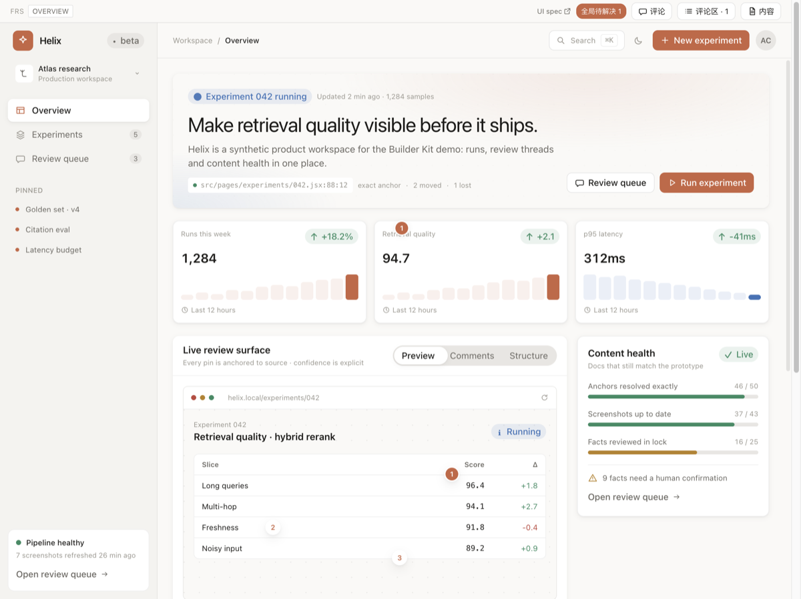
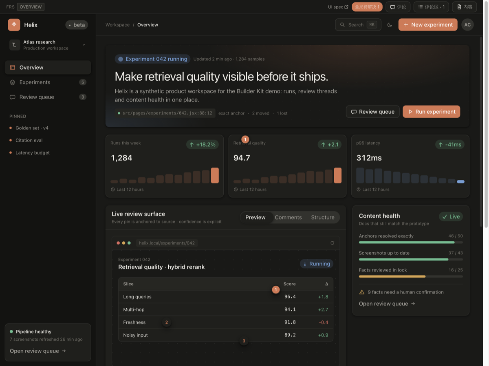
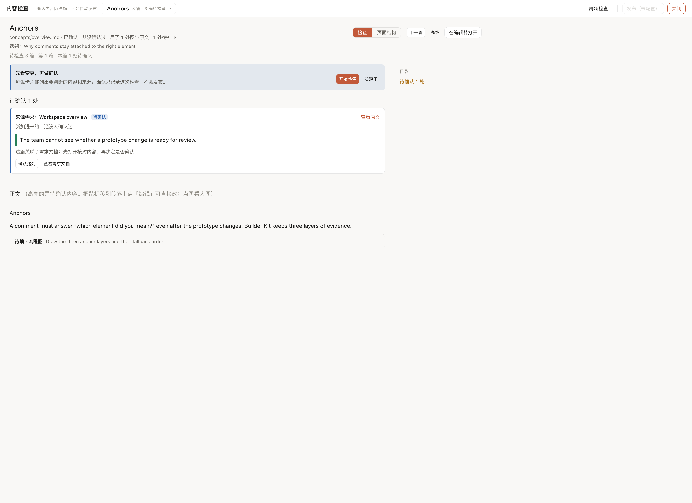

# Builder Kit

面向产品经理与研发的**本地优先**原型工具套件：在活的原型上圈选批注，再把「内容跟不跟得上原型」变成一份可执行的工作清单。

[](./LICENSE)
[](https://nodejs.org/)

[English](./README.md)

两个平级套件，都挂在运行中的原型上：

| 套件 | 收什么 | 落到哪 |
|---|---|---|
| `client/review` | 对原型的**意见** —— 圈选批注 | `docs/reviews/<区域>.json` |
| `client/studio` | 内容跟不跟得上原型的**确认** —— 内容检查台 | `docs/kb/_lock.json`（正文本身在 `docs/kb/*.md`） |

界面是 **React**，挂在 `<body>` 下独立的根上；原型保持自己的框架，不用装 React。**React 是主适配层**（`builder-kit/react`）；**Vue 2**（`builder-kit/vue2`）是可选的兼容适配层。换框架只需按 `client/core/host.js` 写一层很薄的适配。

套件**只在 dev 生效**：入口组件的 `import.meta.env.DEV` 动态 import 在生产构建期被消除，产物里不留任何套件代码。

## 为什么单独一层

原型是产品资产，随业务演进、要整份交付研发；套件是跨原型复用的能力，生命周期完全不同。把套件寄居在原型源码里，后果是「删掉工具层还得动产品代码」。Builder Kit 把两者的边界收敛成宿主工程里的两行配置。

## 做工具时的几条判断

- **一个事实只有一份真源，派生的不存。** 构成视图全由正文算出来，改结构就是改 md。
- **机制不暴露成功能。** 用户要学的只有问题本身的名词（原型页面、截图录屏、文档），节点类型、任务状态是实现。
- **失败要响。** 产物生成了、流程绿灯、内容却是错的，是最坏的失败；判据要显式。
- **按内容判断变没变，不按时间。** 源码哈希、画面比对决定要不要重拍、重发。
- **Agent 只读，落盘与核对在管线里；人的判断不替人做。**

## 安装

```bash
npm install --save-dev builder-kit
# 宿主还没有这些 peer 时
npm install --save-dev vite less
# 仅当宿主使用可选 Vue 2 适配层时
npm install --save-dev vue@2.7
```

要求：Node.js >= 18、Vite >= 5、Vue 2.7（可选，仅使用 Vue 2 适配层与 Vue 源码坐标注入时）、React 18/19（使用 React 适配层时，套件自身已依赖 React）、Tailwind >= 4（使用 `builder-kit/ui` 的规范组件时）、Less >= 3（使用自带样式时）。

## 目录约定

```text
my-prototype/
├── docs/
│   ├── features/<KEY>/FRS.json      # 需求件套（可选）
│   ├── kb/
│   │   ├── outline.config.mjs       # 知识库大纲
│   │   ├── shots.config.mjs         # 截图配方
│   │   ├── clips.config.mjs         # 录屏配方
│   │   └── *.md                     # 正文，唯一真源
│   ├── prd/                         # 生成的 PRD
│   └── reviews/                     # 批注（生成）
├── web/                             # 原型工程（可用 BUILDER_KIT_WEB_DIR 改）
│   └── src/
└── package.json
```

项目根从当前工作目录向上找：最近的包含 `docs/`、`builder-kit.config.*`，或 `package.json` 依赖 `builder-kit` 的目录。也可以用 `BUILDER_KIT_ROOT` 显式指定。

## 接入

### 1. 宿主 `vite.config.js`

```js
import { fileURLToPath, URL } from "node:url";
import { defineConfig } from "vite";
import vue from "@vitejs/plugin-vue2";
import { builderKit } from "builder-kit/vite";

const root = fileURLToPath(new URL(".", import.meta.url));

export default defineConfig({
  plugins: [
    builderKit({
      root,
      frsRegistry: "src/config/frs-map.js",   // 需求区域注册表（业务数据）
      barExtras: ["src/components/common/ThemeToggle.vue"], // 注入工具栏的宿主控件
      barLinks: [{ label: "设计规范", route: { name: "design-system" } }],
      agentPrompt: "",                        // “复制给 Agent”的指令前缀
    }),
    vue(),   // builderKit 内的 anchor-loc 必须先拿到原始 SFC
  ],
});
```

### 2. 挂载 UI（Vue 2 / React）

```js
// App.vue
export default {
  data: () => ({ kitRoot: null }),
  mounted() {
    if (import.meta.env.DEV) {
      import("builder-kit/vue2").then((m) => { this.kitRoot = m.BuilderKitRoot; });
    }
  },
};
```

```vue
<template>
  <component :is="kitRoot" v-if="kitRoot">
    <router-view />
  </component>
  <router-view v-else />
</template>
```

React 原型用 `builder-kit/react`：

```jsx
// main.jsx
import { createRoot } from "react-dom/client";
import App from "./App.jsx";
import { hashRouter } from "builder-kit/react";

const root = createRoot(document.getElementById("root"));

if (import.meta.env.DEV) {
  import("builder-kit/react").then(({ BuilderKitRoot }) => {
    root.render(
      <BuilderKitRoot router={hashRouter()}>
        <App />
      </BuilderKitRoot>,
    );
  });
} else {
  root.render(<App />);
}
```

这两处就是全部集成缝。删掉它们即可剥离整个工具层，生产产物里不留任何痕迹。

### 3. 设计 Token

自带样式使用 `@color-primary`、`@color-border`、`@space-8` 这类语义变量。宿主已有 token 注入时不用管；没有时引入中性默认值：

```js
import { createRequire } from "node:module";
import path from "node:path";

const require = createRequire(import.meta.url);
const kitRoot = path.dirname(require.resolve("builder-kit/package.json"));
const themeDefaults = path.join(kitRoot, "client/core/theme-defaults.less");

export default defineConfig({
  css: {
    preprocessorOptions: {
      less: { additionalData: `@import "${themeDefaults}";` },
    },
  },
});
```

默认值是带 fallback 的 CSS 变量，运行时可以改：

```css
:root { --bk-color-primary: #1677ff; }
```

详见 [docs/styling.md](./docs/styling.md)。

### 4. 使用 UI 规范组件（可选）

仓库内置 **Tool UI Spec**（[`ui-spec/`](./ui-spec)）：令牌、Tailwind 配置与 React 参考组件。

```jsx
import { Badge, Button, Card, Dialog, EmptyState, SegmentedControl, Table } from "builder-kit/ui";
import "builder-kit/tokens.css";
```

令牌管线、Less 桥接与门禁见 [docs/ui-spec.md](./docs/ui-spec.md)。

## 演示原型

[`examples/react-tailwind`](./examples/react-tailwind) 是一个 React + Tailwind 的合成产品原型，完整跑通套件。

| 浅色 | 深色 |
|---|---|
|  |  |




```bash
npm run demo        # 开发服务，默认 http://localhost:5173/#/overview
npm run build:demo  # 生产构建
```

包含源码坐标批注、草稿本地保存、IME 守卫的命令面板、带重试的异步弹窗、深色模式、评审队列，以及完整的 UI 规范页：基础令牌、组件实时状态、组合模式、无障碍说明和可搜索的 Token 表。所有视觉值都来自与套件相同的令牌。

## 发布前检查

发布是对外动作，先扫产物：

```bash
npm run build
node scripts/preflight-dist.mjs --dir dist
node scripts/preflight-dist.mjs --dir dist --deny "corp\\.example\\.com"
```

会拦截开发接口、源码坐标、批注数据路径、本机绝对路径、localhost、source map、私钥与常见凭据。Harness 部署 skill 在新环境下的检测机制与引导建议见 [docs/deploy-skill-review.md](./docs/deploy-skill-review.md)；该评审附隔离式端到端测试（假 CLI、假 registry、假 fetch、临时 HOME）：

```bash
DEPLOY_SKILL=/path/to/deploy.mjs npm run test:deploy-skill
```

## 配置

```js
builderKit({
  root,                 // 宿主应用根，默认 process.cwd()
  frsRegistry,          // 导出 FRS_REGISTRY 的模块，相对 root
  barExtras: [],        // 注入评审工具栏的宿主组件
  barLinks: [],         // [{ label, route, title? }]
  reviewsDir,           // 批注目录，默认 <项目根>/docs/reviews
  anchorLoc: true,      // 非 Vue 原型设为 false
  agentPrompt: "",      // “复制给 Agent”的指令前缀
})
```

环境变量：

| 变量 | 含义 | 默认 |
|---|---|---|
| `BUILDER_KIT_ROOT` | 宿主项目根 | 自动探测 |
| `BUILDER_KIT_DOCS_DIR` | 文档目录，相对项目根 | `docs` |
| `BUILDER_KIT_WEB_DIR` | 原型工程目录，相对项目根 | 有 `web/` 用 `web`，否则项目根 |
| `BUILDER_KIT_ADAPTER` | 管线适配器名 | `vue2-vite` |
| `BUILDER_KIT_PUBLISH_GATEWAY` | 发布目标适配器：路径、`file:` URL 或包名 | 未配置 |
| `BUILDER_KIT_DOCS_CLI` | 内置 `docs-cli` 适配器的命令前缀 | `docs-cli` |

## 内容检查台

**这条链路是一个内容构建系统。** 叙述是手写的源文件，截图录屏是按配方可复现的构建产物，事实是被校验的断言；「上游变了之后，这几句还成立吗」是唯一需要人判断的事。

| 概念 | 在哪 | 谁维护 |
|---|---|---|
| 叙述 | `docs/kb/*.md`，唯一真源 | Agent 或人，在编辑器里写 |
| 截图 / 录屏 | `docs/kb/shots.config.mjs` / `clips.config.mjs` 的配方 → `images/` `media/` | 管线重拍，台账 `_media.json` 记源码快照与产物哈希 |
| 事实 | 正文里 `<!--f 依据-->原文<!--/f-->`，依据是 `frs:` / `code:` / `note:` | 写的人标；`frs:` 对照需求规格原文，`code:` 对照原型源码，`note:` 验不了 |
| 锁 | `docs/kb/_lock.json`：每页审过时每条引用的值 | 人点「确认没问题」或 `kb ack` |
| 蓝图 | 正文里 `<!--intent …-->` 与 `<!--slot 类型 @路由 说明-->`，front-matter 的 `topic` / `type` / `pages` | Agent 提议、人在构成视图里调；发布时剥掉 |

**早截断。** 页面源码变了 → 物料该重拍（按依赖闭包的内容哈希判，不看修改时间）；重拍之后画面没变 → 到此为止，不打扰任何文档。「画面没变」按 16×16 格比灰度，差异格不超过 8 个算没变；高倍截图里一条边线挪 1 个 CSS 像素会碰几百个格子，这类差异再逐像素核一遍。

**审阅台只做三件事：摆出来、记下确认、把活派出去。** 入口在评审工具栏的「内容」，整屏打开：

- 顶栏的「内容」下拉是生产出来的全部篇目，带「几处要看 / 迭代中 / 几个格子待填 / 不发布」标记。
- 文档页把「要看的 N 处」排在上面：截图并排「上次确认时」与「现在」，图下逐条写出变了什么。
- 构成视图是同一份 md 的另一种看法：来源 → 素材与事实 → 章节，画布可缩放、可筛选、可折叠。

**要 Agent 写的活交给 IDE 里的 Agent。** 审阅台不起后台写作 Agent：按钮都是「复制给 Agent」，复制一条指令，粘到 IDE 里的 Agent 对话。`agentPrompt` 可配置指令前缀。

## 命令行

安装后提供统一入口 `builder-kit`（别名 `bk`）：

```bash
npx builder-kit kb status            # 哪些文档要审、哪些图该重拍
npx builder-kit kb context <页|路由>  # 给 Agent：这页的引用、可用配方、可引的规格原文
npx builder-kit kb shoot --stale     # 只重拍源码真变了的
npx builder-kit kb ack <页> [<id>…]  # 我看过了
npx builder-kit kb where <配方|路由|依据> # 谁在引用它
npx builder-kit kb check             # 引用断了才失败，要审只提醒
npx builder-kit kb new <页> <类型> "<话题>" --pages=/a,/b
npx builder-kit review open          # 未解决的批注，带源码坐标
npx builder-kit review resolve <id…> --note "…"
npx builder-kit export-review-notes --status open
npx builder-kit prd <KEY> --scope delta
```

完整列表见 `npx builder-kit --help`。`pipeline/` 下的脚本也可以直接用 `node` 运行。

`check-ui` / `check-routes` / `check-frs` 是**宿主符合性检查的参考实现**，写死了一套设计体系约定（iView 组件、token 文件、导航登记）。换产品时照抄约定或改这三份脚本；其余能力与框架无关。

## 发布

发布是可选的。Builder Kit 只提供核心流程——变更判断、内容打包、计划确认、可续跑状态和审阅台 UI；**发布到哪里**由宿主自己的适配器决定：

```bash
BUILDER_KIT_PUBLISH_GATEWAY=./tools/publish-gateway.mjs npx builder-kit kb-publish --dry-run
```

适配器可以接内部 Wiki、CMS、文档服务或业务数据库。接口契约和最小示例见
[`docs/publishing.md`](./docs/publishing.md)。未配置时发布功能关闭；要使用内置的
[`docs-cli` 参考适配器，设置 `BUILDER_KIT_PUBLISH_GATEWAY=docs-cli`（它仍通过
`BUILDER_KIT_DOCS_CLI` 接收外部 CLI 命令前缀）。完全不接发布目标时，本地批注、内容清单、截图录屏都照常可用。

## 边界规矩

套件**不得 import 任何产品模块**。需要业务侧的东西一律走 `virtual:builder-kit/host` 虚拟模块，由宿主在 Vite 配置里接线。反过来产品代码也只在入口组件一处引用套件。

知识库侧同理：产品内容全在 `docs/kb/` 的几份配置里，套件不含一个产品词。

## 开发

```bash
npm install
npm run check
npm run test:publish-gateway
```

`npm run check` 会做语法检查、路径解析导入、CLI help、UI 规范门禁，并校验 package.json 与 package-lock.json 中的所有依赖都来自 `https://registry.npmjs.org`。仓库已在 `.npmrc` 固定公共 registry，避免本机全局或代理源悄悄改变安装来源。

## 更多文档

- [架构与三层锚点](./docs/architecture.md)
- [宿主与管线适配器](./docs/adapters.md)
- [内容模型](./docs/content-model.md)
- [样式与 Token](./docs/styling.md)
- [UI 规范集成](./docs/ui-spec.md)
- [部署 skill 评审](./docs/deploy-skill-review.md)

## 许可

[MIT](./LICENSE)
